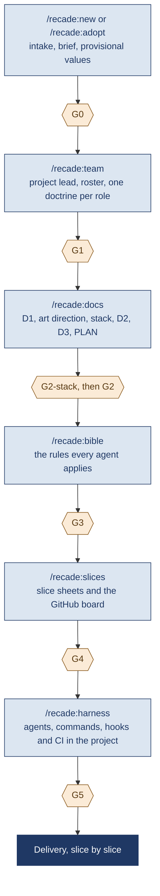
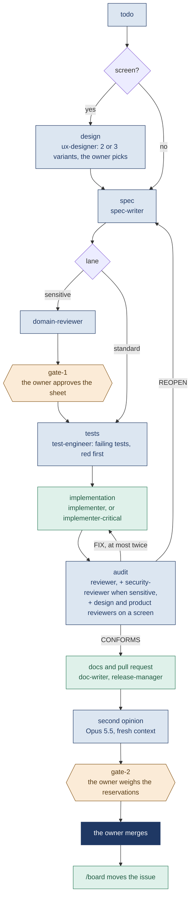

# How Recade delivers

Recade works in two movements. First it frames the project: documents, rules and a plan cut into slices, with the owner's yes at each gate. Then it delivers the plan one slice at a time, each slice in its own worktree, with its own tests, audit and pull request. No agent merges: the owner does.

## 1. Framing: from the idea to the slices

| Phase | What happens | Agents |
|---|---|---|
| Intake | A questionnaire, the brief, and the gaps: each blocking gap is set apart, each other gap gets a provisional value. | `intake-analyst`; in adopt mode `inventory-analyst` (the repositories in place) and `code-reader` (the rules the code already follows) |
| Team | The owner picks the project lead, then approves the team. Each role gets a doctrine drawn from a real expert. | `recruiter`, `doctrine-writer` |
| Documents | D1 (what the product does), the art direction, the stack (a ranked top 5 per layer, finalists tried in real spikes), D2 (architecture), D3 (security), the PLAN. One reviewer per document, one revise round, a word budget per document. | `project-lead`, `ux-designer`, `domain-expert`, `ui-designer`, `stack-analyst`, `spike-runner`, `architect`, `devops-lead`, `security-lead` |
| Rules | The BIBLE: the rules, written so that agents apply them without interpretation. | `bible-writer`, `chief-reviewer` |
| Slices | The PLAN is cut into slices, each with a file scope, a lane and a definition of done. | `slicer` |
| Harness | The project gets its agents, commands, guards and CI, specialised by the team. | the project agents |

During framing the team settles the small, reversible questions itself and lists them at each gate, where the owner can challenge any of them. The owner answers the questions that cost money, bind the client or cannot be undone, up to four at a time. `/recade:amend` changes an approved document: it shows what cites it and takes the project back to the gate that must be passed again.

## 2. Delivery: one slice at a time

Each slice has a sheet, a file scope (`touches:`) and its own worktree. `/slice` delivers one, `/parallel` runs three to five whose scopes do not overlap. The chain depends on the lane of the slice.

| Lane | When | Chain |
|---|---|---|
| `sensitive` | Money, security, personal data, an invariant, a migration, a breaking contract | full spec, domain review, **gate-1**, tests, `implementer-critical`, audit with mutation and security review, docs, pull request, second opinion, **gate-2**, the owner merges |
| `standard` | Everything else | short spec, tests, `implementer`, audit, docs, pull request, the owner merges (the second opinion runs on pull requests over 400 changed lines) |
| `no-code` | A decision or a piece of research | a DEC file with two options and a recommendation, then the owner decides |

When in doubt between two lanes, the stricter one wins.

### The delivery agents

| Agent | Role |
|---|---|
| `spec-writer` | Writes and checks the slice sheet. Ends with `READY` or `GAPS`. |
| `domain-reviewer` | Checks a sensitive sheet against the domain rules, with a source for each finding. |
| `ux-designer` | Two or three really different variants for the screens of a slice, then stops for the owner. |
| `ui-designer` | Design system, components, motion and accessibility, against the art direction. |
| `test-engineer` | One failing test per line of the definition of done and per guardrail, each proved red for the right reason. Writes only test paths. |
| `implementer` | Makes the failing tests pass without changing them, keeps the journal. |
| `implementer-critical` | The same for money, cryptography, invariants, offline state or transactions, and the second fix loop. |
| `reviewer` | One audit pass: conformity to the sheet, each guardrail proved by mutation, gates re-run, honesty of the journal. Ends with `CONFORMS`, `CONFORMS_WITH_RESERVATIONS`, `FIX` or `REOPEN`. |
| `security-reviewer` | The security requirements the sheet cites, the dependencies, the secrets. |
| `design-reviewer` | The screens against the art direction, with screenshots. `ON_DIRECTION` or `FIX`. |
| `product-reviewer` | Looks at the finished screen as its users would, never at the code. |
| `doc-writer` | The guides and the API reference of the slice. |
| `release-manager` | Prepares the pull request: body, human actions, rebase check. Never merges. |
| `second-opinion` | Reviews the pull request with fresh eyes, on Opus 5.5: it reads the PR, the sheet and the requirements, never the reports of the other agents. `CONCURS`, `CONCERNS` or `BLOCKING`. |
| `merge-keeper` | Proposes the merge order, rebases the next pull requests, re-runs the gates. Never merges. |
| `board-keeper` | Summarises what `/board` would move on the GitHub board. |
| `devops` | CI/CD, infrastructure, preview environments, observability. |
| `explorer` | Finds the code and the conventions a task needs. Read only. |
| `test-runner` | Runs lint, type check and tests, and reports the raw result. |
| `code-teacher` | Explains a tool or a part of the project to the owner. Never writes code. |

### The rules that keep it honest

- Loops are bounded: `FIX` goes back to the implementer at most twice, then to the owner. `REOPEN` goes back to the sheet, and to gate-1 in the sensitive lane. `BLOCKING` goes to the owner as written.
- No agent merges, pushes to `main`, skips a git hook or deletes a test. The hooks guard each write against the file scope of the slice. GitHub branch protection is the last barrier.
- A slice across several repositories has one pull request per repository, and is `done` only when all of them are merged.
- `/status` shows every slice, `/board` keeps the GitHub board in step after each merge, `/retro` closes an increment with its delivery metrics.

The full rules, statuses and report blocks are in [harness/protocol.md](../harness/protocol.md), and the reasons behind them in [design.md](design.md).
