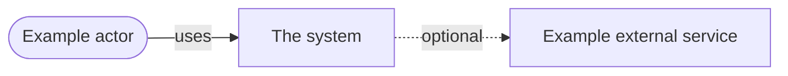
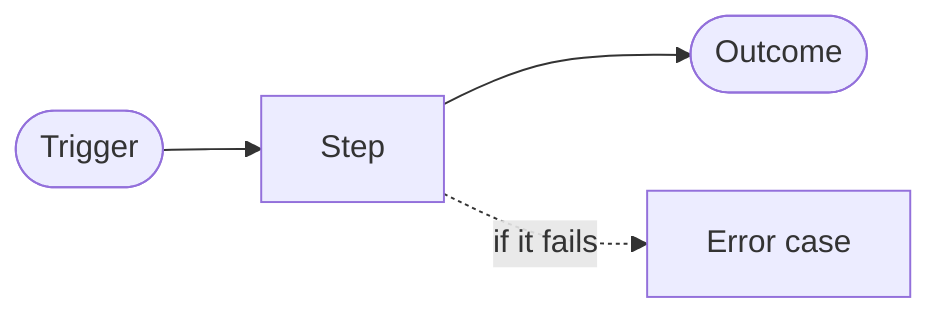
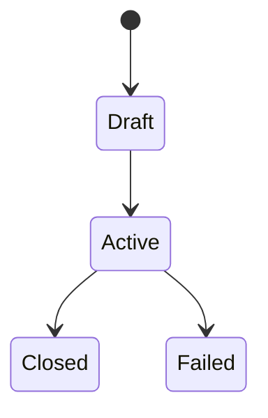

<!--
Writing guide for this document. Delete every comment before the draft goes to the owner.
Size: the dispatcher gives the word budget of D1 (code blocks excluded). Write for a busy client, say each idea once, use a table only for real tabular data, and cite other documents instead of restating them.
D1 says what to build. It does not say how: that is D2. Keep it clear and lively, and serious.
No jokes in rules, exclusions or acceptance criteria. One idea per sentence. Concrete words.
Every requirement is testable: someone can say "done" or "not done" without arguing.
Mark every invented value PROVISIONAL and log it in intake/provisionals.md.
Cite an ID with its gist each time you cite it, and only where it applies: upload a proof of income (FR-EX-01). In running text the gist comes first; the ID is small and muted in the render, so keep it out of the sentence itself.
Required figures, at least three: actors and system context (4.1), the main journeys (6), the states of the main object (8.1). Replace the example figures, never delete them.
Figures: each one is a fenced `mermaid` block with `<!-- caption: ... -->` on the line before it, numbered and listed by the render. Draw plain nodes as they are; add `:::ok` (mint), `:::warm` (cream), `:::error` (light red) or `:::system` (dark navy, the system itself) to a node, and use `-.->` for an optional path. Do not style nodes by hand. A flowchart is read at the width of the page: beyond about 8 nodes in a row, use a top-down layout (`flowchart TD`) and group nodes in `subgraph` blocks, never one long `flowchart LR` chain.
Open each main section with one short sentence in the project voice, then the table or the list.
Write the headings and the fixed words in the document language. Keep the numbers and the order of the sections. An ID column stays `ID`.
-->

## 1. Purpose and reading conventions

<!-- Two or three sentences: who reads this, what it settles, what it leaves to D2 and D3. -->

Identifier grammar: each requirement, parameter, principle and question has one ID, defined once in a table whose first column is `ID`. Everywhere else the ID is cited with its gist.

| Form | Meaning |
|---|---|
| `FR-<MOD>-<nn>` | Functional requirement of module MOD |
| `NFR-<nn>` | Non-functional requirement |
| `PAR-<nn>` | Configurable parameter |
| `PRI-<nn>` | Business principle |
| `Q-<nn>` | Open question |

Priority uses MoSCoW: MUST, SHOULD, COULD, WON'T. Each requirement carries one nature tag: `rule`, `behaviour`, `data`, `screen` or `integration`.

## 2. Context, objectives and scope

### 2.1 Context

<!-- The client, their business, the problem in plain words. -->

### 2.2 Objectives and success indicators

| Objective | Indicator | Target | Measured by |
|---|---|---|---|
| Example objective | Example indicator | Example target (PROVISIONAL) | Example source |

### 2.3 Scope by phase

| Phase | In scope | Date |
|---|---|---|
| Phase 1 | Example capability | 2026-12-01 |

## 3. Non-negotiable business principles

<!-- replace the example rows -->

| ID | Principle | Why it is not negotiable |
|---|---|---|
| PRI-01 | Example principle: money is never moved without a recorded approval | Example reason |

## 4. Actors, surfaces and roles

### 4.1 Actors and surfaces

<!-- replace the example figure -->

<!-- caption: Actors and system context -->

| Actor | Surface | Goal |
|---|---|---|
| Example actor | Web app | Example goal |

### 4.2 Roles by module

| Role | Module A | Module B |
|---|---|---|
| Example role | read | read, write |

## 5. Module catalogue

| Module | Code | What it is for | Activation rule |
|---|---|---|---|
| Example module | EX | Example purpose | Always on |

## 6. End-to-end journeys

<!-- One H3 per journey: who, trigger, numbered steps, outcome. Add a figure when the order matters. -->

### 6.1 Example journey

1. The actor starts from the trigger.
2. The system answers with the next step.
3. The journey ends with a visible outcome.

<!-- replace the example figure: one figure for the main journeys -->

<!-- caption: Main journeys -->

## 7. Requirements per module

### 7.1 Module EX: example module

**Situation.** What the module faces today, in two sentences.

**Rule.** The one rule the module exists to keep.

**What it does not do.** What a reader might expect and will not get.

<!-- replace the example rows -->

| ID | Requirement | Priority | Nature | Acceptance |
|---|---|---|---|---|
| FR-EX-01 | The user can do the example thing | MUST | behaviour | Example check, observable |

## 8. Optional sections

<!-- Keep only what the project needs: lifecycles, public API, compliance, migration. Delete the rest. -->

### 8.1 Lifecycles

<!-- Keep the figure: the states of the main object. Replace the example. -->

<!-- caption: States of the main object -->

### 8.2 Public API

### 8.3 Compliance

### 8.4 Migration

## 9. Non-functional requirements

<!-- replace the example rows -->

| ID | Requirement | Target | Measured by |
|---|---|---|---|
| NFR-01 | Example: a page answers within a stated time | 95th percentile under 800 ms (PROVISIONAL) | Load test |

## 10. Configurable parameters

<!-- replace the example rows -->

| ID | Parameter | Default | Linked decision |
|---|---|---|---|
| PAR-01 | Example parameter | 30 days (PROVISIONAL) | none yet |

## 11. Acceptance criteria per milestone

| Milestone | True on that day | Checked by |
|---|---|---|
| M1 | Example outcome the owner can see | Example demo |

## 12. Exclusions

<!-- What this project will not do. A short list, each line plain enough to settle an argument. -->

- Example exclusion.

## 13. Decisions to close before sign-off

<!-- replace the example rows -->

| ID | Question | Options | Owner | Due | Default if unanswered |
|---|---|---|---|---|---|
| Q-01 | Example question for the owner | A or B | Owner | 2026-12-01 | A |

## 14. Traceability to backlog

<!-- Each story of the backlog covers requirements, and each requirement is covered by a story. The matrix in Annex B is computed. -->

## 15. Acceptance

By signing below, the approvers confirm that this document describes what is to be built.

| Role | Name | Date | Signature |
|---|---|---|---|
| Owner | | | |

## Annex A. Glossary

| Term | Meaning |
|---|---|
| Example term | One plain sentence |

## Annex B. Traceability matrix

<!-- computed at render: not yet implemented -->
