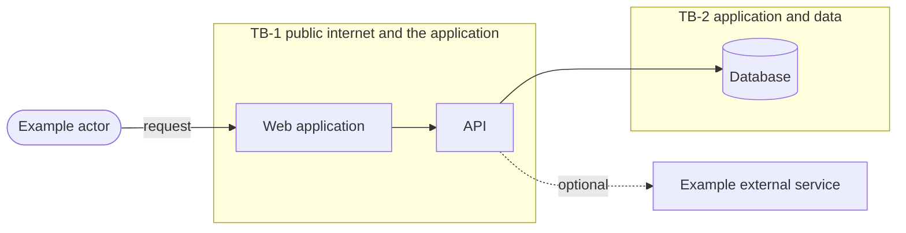

<!--
Writing guide. Delete every comment before the draft goes to the owner.
Size: the dispatcher gives the word budget of D3 (code blocks excluded). Write for a busy client, say each idea once, use a table only for real tabular data, and cite other documents instead of restating them.
D3 is a security document: no humour, no vague word. "Should" means SHOULD, "must" means MUST.
Every requirement can be checked by one named method. Standards carry their version and access date.
Abuse cases are plausible ones: who would do this, and why.
Required figure, at least one: the trust boundaries and the data flows (2.4). Replace the example figure, never delete it.
Figures: each one is a fenced `mermaid` block with `<!-- caption: ... -->` on the line before it, numbered and listed by the render. Draw plain nodes as they are; add `:::ok` (mint), `:::warm` (cream), `:::error` (light red) or `:::system` (dark navy, the system itself) to a node, and use `-.->` for an optional path. Do not style nodes by hand. A flowchart is read at the width of the page: beyond about 8 nodes in a row, use a top-down layout (`flowchart TD`) and group nodes in `subgraph` blocks, never one long `flowchart LR` chain.
Open each main section with one short sentence in the project voice, then the table or the list.
Write the headings and the fixed words in the document language. Keep the numbers and the order of the sections. An ID column stays `ID`.
-->

## 0. Purpose and standards

<!-- Why this document exists and what it covers. Two sentences. -->

| Standard | Version | Accessed | Used for |
|---|---|---|---|
| Example standard | Example version | 2026-11-13 | Example use |

## 1. Security decisions

<!-- The choices that shape everything else: identity provider, data residency, key custody. -->

| Decision | Choice | Reason |
|---|---|---|
| Example decision | Example choice | Example reason |

## 2. Assets, actors, trust boundaries and flows

### 2.1 Assets

| Asset | Why it matters | Where it lives |
|---|---|---|
| Example asset | Example reason | Example place |

### 2.2 Actors and plausible abuse

| Actor | Plausible abuse |
|---|---|
| Example actor | Example abuse, in one sentence |

### 2.3 Trust boundaries

<!-- replace the example rows -->

| ID | Boundary | Crossed by |
|---|---|---|
| TB-1 | Example: the public internet and the application | Every request from a browser |

### 2.4 Flows

<!-- Data flow figure, then one line per sensitive flow. Draw each trust boundary as a subgraph and name it TB-n. Replace the example. -->

<!-- caption: Trust boundaries and data flows -->

## 3. Amendments

<!-- Changes to a decision above, each with its reason. -->

| ID | Amends | Change | Reason |
|---|---|---|---|
| SEC-A01 | Example decision | Example change | Example reason |

## 4. Cross-cutting requirements

<!-- replace the example rows. Same columns in every table of sections 4 and 5. -->

### 4.1 Identity

| ID | Requirement | Priority | Reference | Verification | Status | Owner |
|---|---|---|---|---|---|---|
| SEC-IDN-01 | Example: sessions expire after a stated idle time | MUST | Example standard, example item | test | open | Security lead |

### 4.2 Cryptography

| ID | Requirement | Priority | Reference | Verification | Status | Owner |
|---|---|---|---|---|---|---|
| SEC-CRY-01 | Example: keys are rotated on a stated schedule | MUST | Example standard, example item | config review | open | Security lead |

### 4.3 Logging

| ID | Requirement | Priority | Reference | Verification | Status | Owner |
|---|---|---|---|---|---|---|
| SEC-LOG-01 | Example: every sign-in and refusal is logged with a time and an actor | MUST | Example standard, example item | test | open | Security lead |

### 4.4 Data

| ID | Requirement | Priority | Reference | Verification | Status | Owner |
|---|---|---|---|---|---|---|
| SEC-DAT-01 | Example: personal data is encrypted at rest | MUST | Example standard, example item | config review | open | Security lead |

### 4.5 Backup

| ID | Requirement | Priority | Reference | Verification | Status | Owner |
|---|---|---|---|---|---|---|
| SEC-BAK-01 | Example: a restore is rehearsed on a stated schedule | SHOULD | Example standard, example item | drill | open | Security lead |

### 4.6 Software development lifecycle

| ID | Requirement | Priority | Reference | Verification | Status | Owner |
|---|---|---|---|---|---|---|
| SEC-SDL-01 | Example: dependencies are audited on every pull request | MUST | Example standard, example item | test | open | Security lead |

### 4.7 Infrastructure

| ID | Requirement | Priority | Reference | Verification | Status | Owner |
|---|---|---|---|---|---|---|
| SEC-INF-01 | Example: no administration port is open to the internet | MUST | Example standard, example item | config review | open | Security lead |

## 5. Per-component requirements

<!-- One H3 per component. Same columns as section 4. -->

### 5.1 Example component

## 6. Channels and operational security

<!-- Payment and notification channels, secrets handling, on-call and incident response. -->

## 7. Coverage matrix

<!-- One row per standard item, with the requirements that cover it, or the reason it does not apply. -->

| Standard item | Covered by | Note |
|---|---|---|
| Example item | SEC-IDN-01 (idle session expiry) | |

## 8. Residual risks

<!-- replace the example rows -->

| ID | Risk | Why it stays | Accepted by |
|---|---|---|---|
| RSK-02 | Example residual risk | Example reason | Owner |

## 9. Induced backlog items

<!-- Work that these requirements add to the plan. Each line names the requirement it comes from. -->

| Item | Comes from | Size |
|---|---|---|
| Example item | SEC-IDN-01 (idle session expiry) | S |

## 10. Open decisions and accepted risks

| Subject | Options | Owner | Due |
|---|---|---|---|
| Example subject | A or B | Owner | 2026-12-01 |
