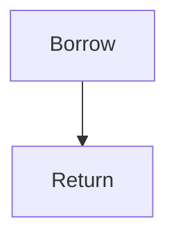
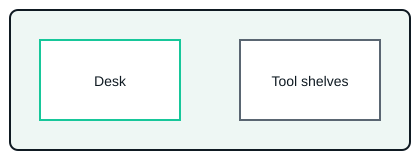

# Vision

Fernhill Lending lets neighbours borrow **tools** *without* paperwork. The loan period is `7 days`, see the [rules](https://example.org/rules).
Quotes "like this" & a < b stay literal, and the café keeps its accent.

## Scope

The late fee is PROVISIONAL until the board votes (PRV-03).

- Members borrow tools
  - Drills and ladders
- Volunteers run the desk

1. Join
2. Borrow

## Scope

### Détails: accents

##### A deep heading

<!-- widths: 20,50,30 -->
| Role | Duty | Note |
|---|---|---|
| Member | Borrows tools | Needs a card |
| Volunteer | Runs the desk |

## Requirements

| ID | Title | Rule \| note |
|---|---|---|
| FR-LND-01 | Borrow a tool | Loan lasts 7 days |
| FR-LND-02 | Return a tool | Late fee, see PRV-03 |

| Name | Value |
|---|---|
| Opening hours | Saturday only |

> [!NOTE]
> Members need no account to browse.

> [!WARNING]
> Never lend a saw without a safety briefing.

> [!DECISION]
> The desk is volunteer-run.

> A plain quote becomes a note.

<!-- caption: Loan flow -->





<!-- A comment that is dropped -->

```js
const days = 7;
```

<!-- pagebreak -->

## Closing

Next steps are in D2.
